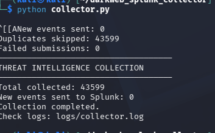
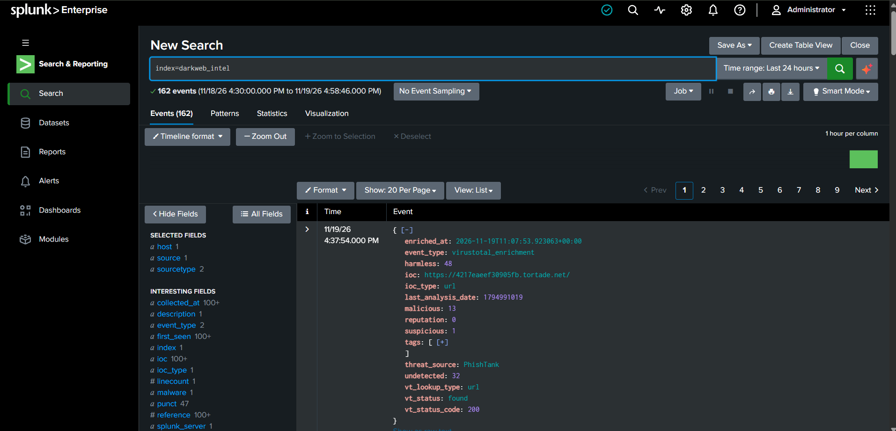
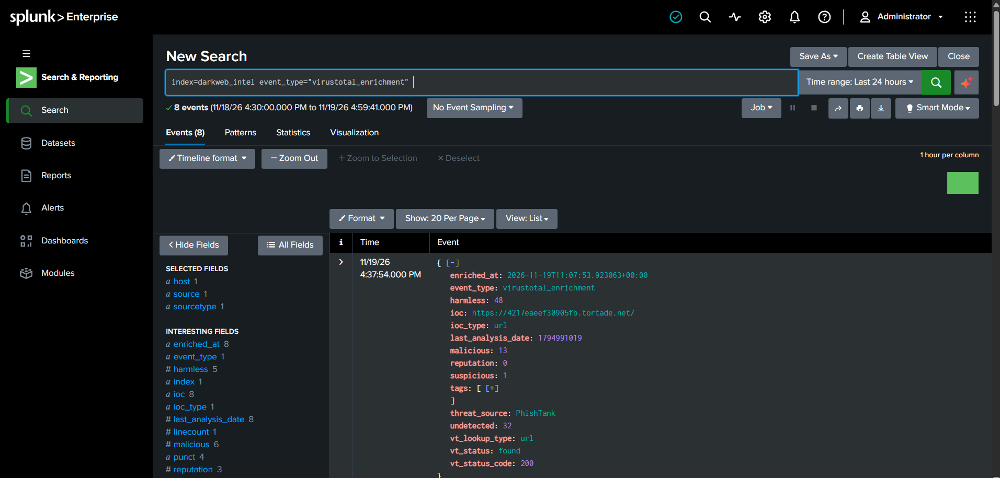

# Automated Threat Intelligence Collection and IOC Enrichment Using Splunk

## About the Project

This project focuses on automating threat intelligence collection and IOC (Indicator of Compromise) enrichment using Python, Kali Linux, VirusTotal and Splunk Enterprise.

It collects threat indicators from public threat intelligence sources, processes and stores them using SQLite, and uses the VirusTotal API to retrieve additional information about collected indicators.

The collected and enriched events are forwarded to Splunk for monitoring and analysis.

The project was developed in a home lab environment using Kali Linux in VMware and Splunk Enterprise installed on a Windows 11 laptop.

## Lab Architecture

```text
Threat Intelligence Sources
       |
       v
   Kali Linux
   (VMware)
       |
       v
 Python Collector
       |
       v
 IOC Processing
       |
       v
 SQLite Database
 (Deduplication)
       |
       v
 VirusTotal API
 (IOC Enrichment)
       |
       v
 Splunk HEC
 (Port 8088)
       |
       v
 Splunk Enterprise
 (Windows 11)
       |
       v
 Monitoring and Analysis
```

## Tools and Technologies

| Tool | Purpose |
|---|---|
| Kali Linux | Linux environment for running Python scripts |
| Python | Threat intelligence collection and enrichment |
| AlienVault OTX | Threat intelligence collection |
| URLhaus | Public malicious URL intelligence feed |
| PhishTank | Public phishing URL intelligence feed |
| ThreatFox | Additional threat intelligence integration in the collector |
| VirusTotal | IOC reputation checking and enrichment |
| SQLite | IOC storage, deduplication and enrichment cache |
| Splunk Enterprise | Security monitoring and analysis |
| Splunk HEC | Event forwarding to Splunk |
| VMware | Virtual machine environment |
| Windows 11 | Host operating system |

## Key Features

- Collects threat intelligence indicators from multiple sources.
- Normalizes IOCs into a consistent event format.
- Uses SQLite for IOC deduplication.
- Enriches collected indicators using the VirusTotal API.
- Retrieves existing VirusTotal analysis reports.
- Uses caching to reduce repeated VirusTotal API requests.
- Applies request limits to manage API usage.
- Forwards collected and enriched events to Splunk through HTTP Event Collector.
- Maintains logs for collection and enrichment activities.

## How the Project Works

### 1. Threat Intelligence Collection

The Python collector retrieves indicators from configured threat intelligence sources, including AlienVault OTX, URLhaus and PhishTank.

ThreatFox is also supported by the script but requires its authentication key.

### 2. IOC Processing and Deduplication

Collected indicators are normalized into a common format.

SQLite stores previously submitted indicators. A SHA-256-based key is used to identify duplicate records and avoid repeatedly forwarding the same IOC from the same source.

### 3. VirusTotal Enrichment

The VirusTotal enrichment script reads existing IOC records from the SQLite database and queries the VirusTotal API.

It retrieves available reputation and analysis information, such as:

- Malicious detections
- Suspicious detections
- Harmless detections
- Undetected results
- Reputation information

The script also maintains an enrichment cache and applies request limits.

It retrieves existing VirusTotal reports; it does not upload files or submit URLs for scanning.

### 4. Splunk Integration

The Python scripts forward events to Splunk using HTTP Event Collector (HEC).

Two event categories are used:

- `threatintel:json` – threat intelligence collection events.
- `virustotal:json` – VirusTotal enrichment events.

The default configured Splunk index is:

`darkweb_intel`

### 5. Monitoring and Analysis

Splunk Search & Reporting is used to inspect collected indicators and enrichment results.

Example SPL searches:

**View threat intelligence events**

```spl
index=darkweb_intel
```

**View indicators by threat source**

```spl
index=darkweb_intel
| stats count by threat_source
```

**View VirusTotal enrichment events**

```spl
index=darkweb_intel event_type="virustotal_enrichment"
```

## Project Environment

- Host Operating System: Windows 11
- Virtual Machine: Kali Linux
- Virtualization: VMware
- SIEM: Splunk Enterprise
- Event Forwarding: Splunk HTTP Event Collector
- HEC Port: 8088

Kali Linux communicates with the Windows host through the configured virtual network to forward events to Splunk.

## Repository Structure

```text
automated-threat-intelligence-splunk/
│
├── README.md
├── .gitignore
│
└── collector/
    ├── collector.py
    ├── virustotal_enricher.py
    ├── requirements.txt
    └── .env.example
```

## Configuration and Security

The project uses environment variables for API keys and Splunk HEC configuration.

The configuration includes:

- `OTX_API_KEY`
- `THREATFOX_AUTH_KEY`
- `URLHAUS_AUTH_KEY`
- `PHISHTANK_APP_KEY`
- `VT_API_KEY`
- `SPLUNK_HEC_URL`
- `SPLUNK_HEC_TOKEN`
- `SPLUNK_INDEX`

Some feed authentication keys are optional in the collector.

**Security precautions:**

- Actual API keys and HEC tokens must remain in a private `.env` file.
- Never upload `.env` or other files containing secrets to GitHub.
- Use `.env.example` as a public configuration template.
- Restrict Splunk HEC access to trusted lab systems.
- Follow the API usage limits and terms of the respective services.

## What I Learned

Through this project, I gained practical experience with:

- Python-based security automation.
- Threat intelligence feeds and IOC handling.
- API integration and authentication.
- SQLite database operations and deduplication.
- VirusTotal IOC reputation enrichment.
- Splunk HTTP Event Collector integration.
- Event ingestion and SPL searches.
- Building a small-scale SOC monitoring workflow.

## Project Screenshots

### 1. Collector Execution


### 2. IOC Events in Splunk


### 3. VirusTotal Enrichment in Splunk


## Disclaimer

This project was developed for educational and cybersecurity lab purposes.

It uses publicly available threat intelligence sources and their APIs. The project does not perform unauthorized access, malware deployment or Tor network crawling.

VirusTotal reputation results are investigation signals and should not be treated as definitive proof of compromise or safety.

---

**Author:** Ashitha Panicker

Aspiring SOC Analyst | Blue Team Enthusiast
